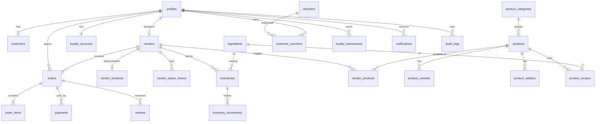

# HAFFYE — Architecture (Phase 1)

## Stack on Vercel
```
Browser (PWA, Leaflet) ──HTTPS──► Next.js on Vercel (Server Components, Route Handlers, Server Actions)
        │                                   │ (anon key + user JWT via cookies; service role only on server)
        └──── WebSocket (Realtime) ────────► Supabase (Postgres + RLS, Auth, Realtime, Storage)
Midtrans ──webhook──► /api/payments/webhook (signature verified) ──► Supabase (service role)
Vercel Cron ──► /api/cron/* (CRON_SECRET) ──► cleanup_stale_locations(), payment expiry
```
No Express, no Socket.IO, no in-memory state: every request is stateless.

## Folder structure
```
src/
  app/
    (auth)/login, register        public auth pages
    customer/ barista/ admin/     role areas (guarded by middleware + requireRole)
    actions/                      Server Actions (auth now; orders, inventory later)
    api/                          Route Handlers (vendor/location, payments/webhook, cron)  [Phase 3-4]
  components/                     UI (auth forms, role shell; shadcn ui added in Phase 2)
  lib/
    supabase/{client,server,admin,middleware}.ts
    auth.ts roles.ts utils.ts validators/
  middleware.ts                   session refresh + role-based route guard
supabase/migrations/              schema, functions, RLS
supabase/seed.sql
docs/
```

## Auth & RBAC (defense in depth)
1. `middleware.ts` validates the JWT (`getUser`) and redirects by role.
2. `requireRole()` re-checks on every server page/action.
3. Postgres RLS is the final authority.
4. Public sign-up always yields `customer` (DB trigger). A trigger blocks users from changing their own `role`/`is_active`. Admins promote baristas and link them to a `vendors` row.

## Key DB design decisions
- `vendor_locations` holds **latest** position only (PK = vendor_id) → cheap upserts + Realtime; trigger rejects writes unless vendor is ACTIVE/BUSY; going OFFLINE/PAUSED deletes the row; `cleanup_stale_locations()` purges old rows.
- Orders are created server-side only (service role) after server validation; `unique(customer_id, idempotency_key)` blocks duplicates; `order_items` snapshot name/price.
- Payments: `payment_events` unique on (order, status, code) gives duplicate-callback protection.
- Inventory: `quantity >= 0` check + `apply_stock_movement()` and `complete_order()` run in one transaction with row locks.

## ERD


## Deferred (called out, not forgotten)
- **Rate limiting**: serverless has no shared memory; will use Upstash Redis (`@upstash/ratelimit`) on GPS, order, and auth endpoints in Phase 3/4.
- **Background GPS** is not promised: browsers throttle geolocation when backgrounded; UI will show stale warnings.
